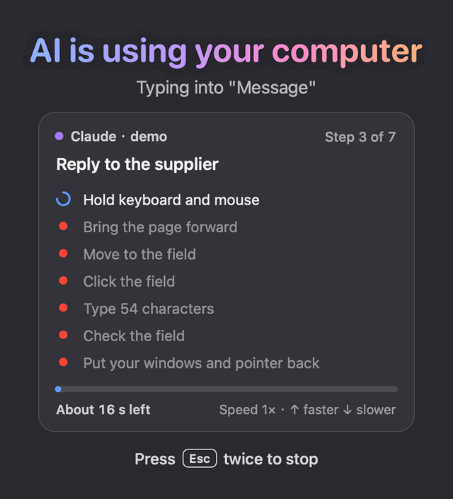

# MyChrome

**Keep browsing. Bring in AI when you need a hand.**

MyChrome is a local MCP server with a native macOS app. It lets Codex, Claude Code and other local stdio MCP clients work in the Google Chrome you already use, with your existing tabs, signed-in accounts and real mouse and keyboard.

[Website](https://shuaige121.github.io/mychrome-mcp/) · [Source installation and permissions](https://shuaige121.github.io/mychrome-mcp/getting-started.html) · [MyChrome FAQ](https://shuaige121.github.io/mychrome-mcp/faq.html) · [中文](README.zh-CN.md)

<p align="center">
  
</p>
<p align="center"><sub>The takeover card MyChrome shows while your assistant uses the mouse and keyboard.<br>Rendered from MyChrome's own code with a sample task; not a screen recording.</sub></p>


## When to use MyChrome vs. other browser tools

- **Public pages and APIs.** Use an API or web fetch first for public information.
- **JavaScript pages without a login.** Use headless Playwright first when the page does not need your signed-in session.
- **Your own Chrome, login or shared page.** Use MyChrome when the task needs your existing tabs, signed-in accounts or a page you and your assistant are working on together.
- **Sites that block automation.** Website compatibility depends on the site, account permissions and current page. At a CAPTCHA or bot check, MyChrome stops and hands over; it does not solve it. On access denial or rate limits, the assistant should stop and report.

## How it works

1. Browse as usual with your tabs and signed-in accounts.
2. In your existing AI conversation, name the page (title or URL) and the outcome. The assistant reads it first, works within your authorization and checks the result.
3. Take over for passwords, verification codes or other personal steps.
4. Explicitly say “continue” in the original conversation. The assistant should reread the page before resuming.

Continuation follows the assistant’s instructions; MyChrome does not enforce a cross-client continuation gate.

## Example requests

These are example requests, not verified case studies:

- Update my LinkedIn page with the details I provide.
- Check my Facebook notifications and messages for people trying to reach me.
- Publish the article I wrote to the Facebook, Xiaohongshu, Reddit or LinkedIn accounts I specify.

Compatibility depends on the site, account permissions and current page; no workflow is guaranteed.

## You stay in control

Press Esc twice within 0.8 seconds to stop the current agent and regain the mouse and keyboard. A new instruction is needed before another takeover. Stopping does not undo actions already sent. The pause control blocks further input from every connection. During takeover, ordinary physical input is intercepted; the takeover card shows the agent, task, checklist, time left and speed. Physical actions from several agents queue for one pointer and keyboard; page reads can run together.

No. At a CAPTCHA or bot check, MyChrome stops and hands over. On access denial or rate limits, the assistant should stop and report the restriction, without retrying or switching tools to get around it.

## At your pace

Choose follow-task, key-by-key or paste input, with typing, pointer and scrolling speed from 0.5× to 3×. Use paste for Chinese or other text key-by-key input cannot type. Optional personal input habit sampling is experimental: a 3-minute sample supplies timing statistics for later input; values without enough samples keep defaults. You can turn it off, resample or delete it. Only a local statistical summary is stored: no keys, typed text, screen coordinates, window or app names, or screenshots; raw events are never written to disk. It is not a behavioural clone and does not guarantee a site will accept automation.

## Works with your assistant

Yes. New conversation (⌘N) starts a separate conversation with an installed, signed-in CLI, a model from that CLI, a supported reasoning effort and a working folder; the first task is optional. These choices do not rewrite client configuration. App-created conversations show live text, follow-up replies and supported questions or approval requests. Stop generation interrupts them. Closing the app leaves them running; reopening rejoins them while the backend process is alive, with no automatic recovery after it exits. An existing Codex conversation needs a supported local integration and an associated thread.

MyChrome runs on the Mac whose Chrome it controls. Your AI client supplies model access under its own account; its charges or subscription may apply.

## New in 0.15.0

- **Claude Code conversation mirror.** In 0.15.0, a terminal Claude Code session connected to MyChrome appears as a read-only mirror of your prompts and Claude’s reply text from connection time. During takeover, the sidebar shows Claude’s reply text. Thinking, tool calls and tool results are not shown. You reply in the terminal; MyChrome never types into it. Mirror text stays in memory and is not written to logs or files. It is on by default; set `CHROME_BRIDGE_CLAUDE_FEED=0` in the MCP server’s environment and reconnect the MCP client to turn it off.

- **Focus handling.** In 0.15.0, MyChrome brings Google Chrome forward before acting when it is not in front. It uses the pointer landing point and checks the page’s keyboard focus before every key. If it still cannot act, it returns quickly and says what was in front and whether anything was sent.

- **A bounded wait for text recognition.** In 0.15.0, if text recognition is slow, a screenshot returns about 8 seconds after recognition starts, with the image and a note that the text was not ready. Background warm-up checks for ongoing input before starting and defers when it finds any.

- **Use the page you already have open.** In 0.15.0, when you ask the assistant to work on a page you already have open or in your own Google Chrome, MyChrome’s instructions direct it to that exact tab ahead of other browser tools. Reconnect the MCP client to receive the new instructions.

- **MyChrome in your language.** In 0.15.0, MyChrome’s windows and notifications follow your Mac’s language (English or Chinese), with a Language setting under Settings in the menu bar panel. The takeover card and sidebar also follow that language. You can set `CHROME_BRIDGE_UI_LANG=en|zh`; agent-facing tool text does not change.

## Get started

Codex and Claude Code can use the browser tools; other local stdio MCP clients can connect with the printed paths. You need an Apple Silicon Mac with macOS 13+, Google Chrome in `/Applications`, native arm64 Node.js 24+ recommended (20.19+ and 22.13+ also supported), Git and Xcode Command Line Tools. Intel Macs, Rosetta Node, Windows, Linux and other browsers are not supported. MyChrome runs on the Mac whose Chrome it controls.

```bash
git clone https://github.com/shuaige121/mychrome-mcp.git
cd mychrome-mcp
bash scripts/setup.sh
```

Setup checks prerequisites, installs dependencies, builds native helpers, installs the app in `~/Applications` and checks permissions. It does not change your AI client’s configuration or grant macOS permissions. Keep the checkout in place. MyChrome is installed from source and is not published to npm.

Run `bash scripts/setup.sh --instructions` for the client connection commands. Use `node src/index.js doctor` to check permissions. No extension, debugging port or separate browser profile is needed; page reading uses Chrome’s “Allow JavaScript from Apple Events” setting.

In 0.15.0, MyChrome’s windows and notifications follow your Mac’s language (English or Chinese), with a Language setting under Settings in the menu bar panel. You can also set `CHROME_BRIDGE_UI_LANG=en|zh`. Agent-facing tool text does not change.

## Data and privacy

MyChrome runs locally, and screenshots and text recognition run on the Mac using Apple Vision. Page content returned through MCP goes to your AI client and is handled under that client’s settings. Website routine recording of local action metadata is on by default and can be turned off. Typed and selected values are not saved as replay defaults. Local records and routine metadata may reveal which sites you use; keep runtime records private.

Saved sequences replay with fresh values on a tab you select, without model calls between steps. They stop when the page or target no longer matches. Routine completion is not proof of a business outcome.

## Learn more

- [Source installation and permissions](https://shuaige121.github.io/mychrome-mcp/getting-started.html)
- [MyChrome FAQ](https://shuaige121.github.io/mychrome-mcp/faq.html)
- [AI agent guide](docs/ai-guide.md)
- [Conversation center](docs/conversation-center.md) and [website routines](docs/routines.md) (both in Chinese)
- [Release notes](docs/release/CHANGELOG.md) · [Contributing](CONTRIBUTING.md) · [Support](SUPPORT.md) · [Security](SECURITY.md)

[MIT License](LICENSE) · Copyright Leonard Chow. MyChrome is an independent project, not affiliated with or endorsed by Google. Chrome is a trademark of Google LLC.
