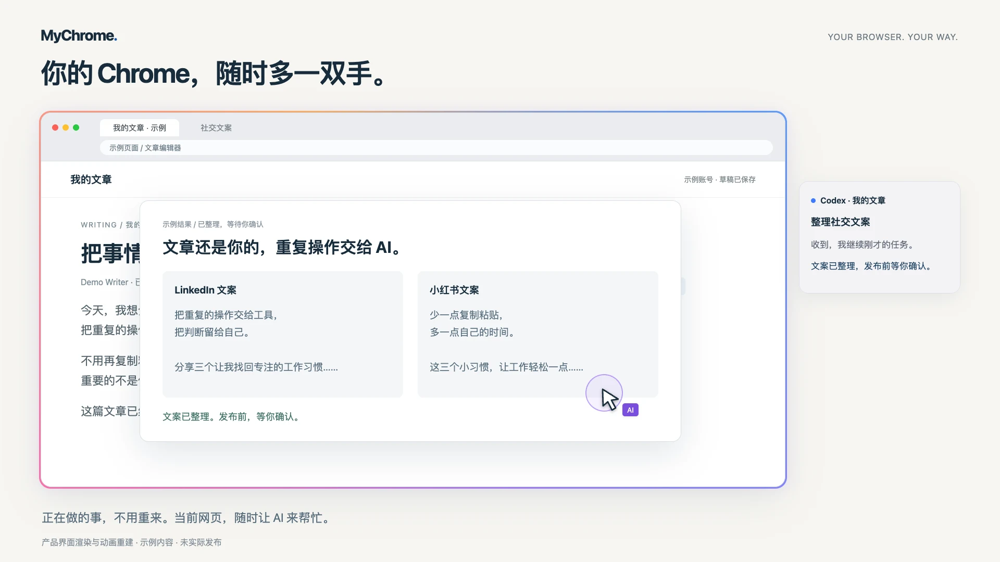

# MyChrome

**你的 Chrome，随时多一双手。**

你照常用 Chrome，需要帮忙时，随时让 AI 介入同一个页面办事。正在用的账号、已开的标签页和原来的对话都能接着用。

MyChrome 让助手读取页面，用真实鼠标和键盘完成操作。遇到需要你本人输入的密码、验证码，就把页面交回给你；你处理好并明确说“继续”后，AI 重新读取页面，接着原来的任务做。

[开始使用](docs/getting-started.zh-CN.md) · [English](README.md) · [产品网站](https://shuaige121.github.io/mychrome-mcp/zh/) · [常见问题](https://shuaige121.github.io/mychrome-mcp/zh/faq.html)

[](https://shuaige121.github.io/mychrome-mcp/zh/#film)

[观看短片](https://shuaige121.github.io/mychrome-mcp/zh/#film) · [MP4](site/assets/mychrome-overview.mp4) · [22 秒 GIF](site/assets/mychrome-overview.gif) · [英文字幕](site/assets/mychrome-overview.en.vtt)

产品界面渲染与动画重建，使用示例内容，未实际发布。片中的会话中心展示受支持的 Codex 集成。

## 贴近你的操作习惯

选择逐字输入或粘贴，把打字、鼠标移动和滚动的节奏调到 0.5×–3×。你的设置会应用到后续操作。

还可以在**我的操作习惯**中自选采样三分钟键鼠节奏，拟合成后续输入使用的节奏统计。这是实验功能，可以启用、关闭、重新采样或删除；只记录节奏统计，不保存你打的正文，也不录屏。

## 需要时，把这些事交给 AI

以下是可以提出的需求示例，不代表这些平台流程已经逐一验证：

- **整理自己的 LinkedIn page。** “用我已打开的 LinkedIn 页面，按我们定好的文案整理介绍和栏目，完成后告诉我改了哪里。”
- **看看有没有人找我。** “看一下我打开的 Facebook，检查通知和消息，告诉我有哪些人需要回复。”
- **分发已经写好的文章。** “按我提供的各平台文案，把这篇文章发到我指定的 Facebook、小红书、Reddit、LinkedIn 账号，完成后给我每条结果和链接。”

在原来的 AI 对话里给出页面标题或 URL。助手先读实际页面、识别目标，再推进你已授权的任务并核对结果；目标不明、缺少资料或需要新的决定时再问你。

MyChrome 是本机运行的 MCP server，带原生 macOS 界面，无需 Chrome 扩展或调试端口。具体网站能否完成任务取决于页面；登录和网站验证可能需要你接手。

## 开始使用

需要 **Apple Silicon Mac、macOS 13+、安装在 `/Applications` 的 Google Chrome、Node.js 24+（推荐）、Git 和 Xcode Command Line Tools**。也支持 Node 20.19+、22.13+。缺少命令行工具时运行 `xcode-select --install`。

```bash
git clone https://github.com/shuaige121/mychrome-mcp.git
cd mychrome-mcp
bash scripts/setup.sh
```

安装程序检查环境、安装依赖、编译原生辅助程序，并将 MyChrome 安装到 `~/Applications`。它会指出缺失权限，给出当前路径对应的客户端连接命令。请保留源码目录的位置，App 和 AI 客户端会继续使用它。

按[首次使用指南](docs/getting-started.zh-CN.md)完成授权和客户端连接，再回到原来的 AI 对话与想处理的 Chrome 页面。当前版本通过源码安装，尚未发布到 npm。

## 客户端支持

| 能力 | Codex | Claude Code | 其他本机 MCP 客户端 |
|---|---|---|---|
| 读取和操作 Chrome | 支持 | 支持 | 需要支持 stdio MCP |
| 把页面交回给你 | 支持 | 支持 | 通过浏览器工具 |
| 在 MyChrome 中显示实时回复并直接对话 | 需要支持的 Codex 集成及已关联会话 | 暂不支持 | 未提供适配器 |

MyChrome 必须运行在 Chrome 所在的 Mac 上。模型及其账号或订阅由你的 AI 客户端提供。

入门引导支持中英文切换；主工作区目前使用中文界面。

## 和 AI 共用桌面

AI 使用这台 Mac 的真实鼠标和键盘。接管期间，普通物理输入会被拦截；**快速连按两次 Esc** 可收回控制。停止后，AI 必须等你的新指令才能再次接管。停止不会撤销已发出的操作。页面读取可以并行，实际键鼠操作依次进行。

在**操作设置**调整输入方式、速度和可选的习惯采样。输入中文等逐字模式不支持的文字时，选择粘贴。

在**网站流程**中检查已记录步骤、保存连续片段、填写新参数，再明确选择现有标签页。页面或目标不匹配时会停止。支持的控件及限制见[网站流程指南](docs/routines.md)。

## 数据与隐私

MyChrome 在本机运行。通过 MCP 返回的页面内容会交给 AI 客户端，并受其设置约束。本机操作记录和流程元数据可能反映你使用过的网站；流程记录默认开启，可以关闭，输入正文和选项值不会保存为重放默认值。请将运行记录留在本机。

## 更多说明

- [首次使用与故障处理](docs/getting-started.zh-CN.md)
- [完整使用说明](docs/usage.zh-CN.md) · [AI 操作指南](docs/ai-guide.md)
- [会话窗口](docs/conversation-center.md) · [网站流程](docs/routines.md) · [更新记录](docs/release/CHANGELOG.md)
- [贡献指南](CONTRIBUTING.md) · [获取帮助](SUPPORT.md) · [安全问题](SECURITY.md)

[MIT License](LICENSE) · Copyright 2026 Leonard Chow。MyChrome 是独立项目，与 Google 没有隶属或背书关系。Chrome 是 Google LLC 的商标。
