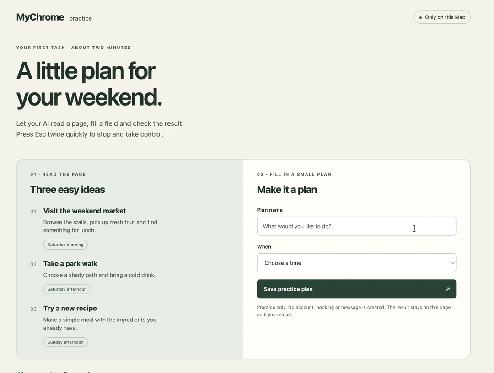
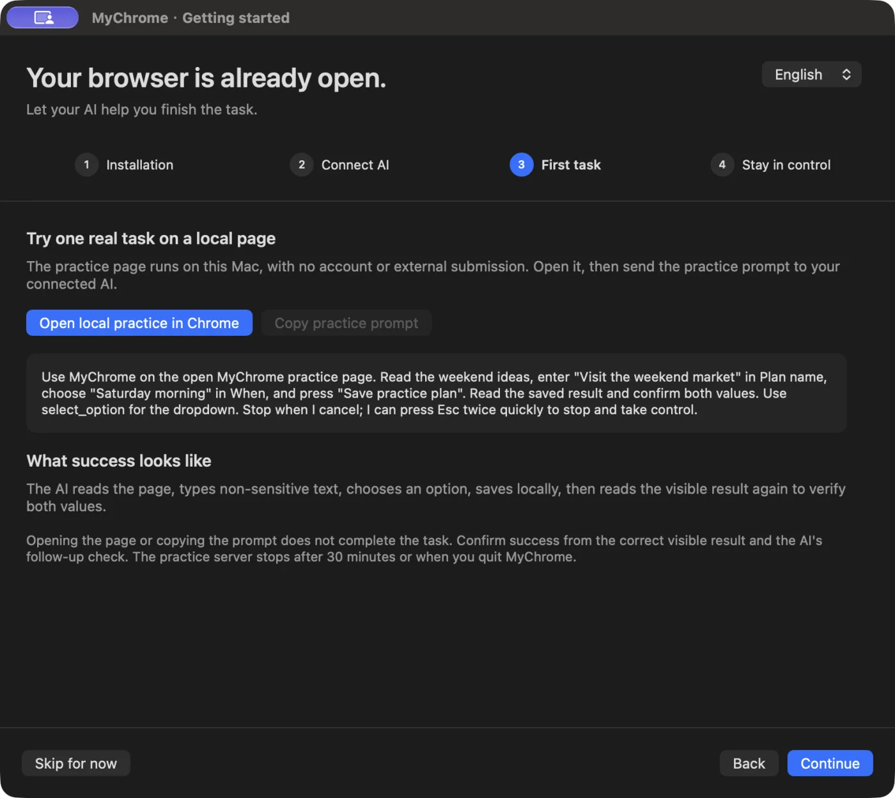

# MyChrome

**浏览器已经打开，让 AI 帮你把事情做完。**

MyChrome 把 AI 助手连接到你 Mac 上正在使用的 Google Chrome。保留已登录的页面和工作上下文，让 AI 用真实鼠标和键盘帮你读页面、填表、完成操作；需要时，随时接回来。

[开始使用](docs/getting-started.zh-CN.md) · [English](README.md) · [产品网站](https://shuaige121.github.io/mychrome-mcp/zh/) · [常见问题](https://shuaige121.github.io/mychrome-mcp/zh/faq.html)

[](site/assets/mychrome-practice.gif)

**点击图片播放真实本地练习。** 约 27 秒 · 2 倍速 · 剪去等待间隔 · 裁掉浏览器工具栏。使用虚构练习内容。[在网站中观看，可随时停止播放](https://shuaige121.github.io/mychrome-mcp/zh/#demo)。

## 帮你完成日常工作

- **接着当前页面做。** 告诉助手要用哪个页面、完成什么，不必把工作搬到另一个浏览器会话。
- **少做重复操作。** 读取信息、填写内容、选择选项，并在操作后核对页面结果。
- **控制权留在手里。** 快速连按两次 **Esc** 停止当前 AI；**暂停 AI 操作** 阻止所有连接继续输入。
- **把合适的步骤留下。** 将连续操作保存为网站流程，下次提供新参数、明确选择标签页后运行。

MyChrome 是本机运行的 MCP server，带原生 macOS 界面，无需 Chrome 扩展或调试端口。具体网站能否完成任务取决于页面；登录和网站验证可能需要你接手。

## 开始使用

需要 **Apple Silicon Mac、macOS 13+、安装在 `/Applications` 的 Google Chrome、Node.js 24+（推荐）、Git 和 Xcode Command Line Tools**。也支持 Node 20.19+、22.13+。缺少命令行工具时运行 `xcode-select --install`。

```bash
git clone https://github.com/shuaige121/mychrome-mcp.git
cd mychrome-mcp
bash scripts/setup.sh
```

安装程序检查环境、安装依赖、编译原生辅助程序，并将 MyChrome 安装到 `~/Applications`。它会指出缺失权限，给出当前路径对应的客户端连接命令。请保留源码目录的位置，App 和 AI 客户端会继续使用它。

按[首次使用指南](docs/getting-started.zh-CN.md)完成授权、连接客户端和内置离线练习。当前版本通过源码安装，尚未发布到 npm。

<details>
<summary>查看原生首次使用引导</summary>



</details>

## 客户端支持

| 能力 | Codex | Claude Code | 其他本机 MCP 客户端 |
|---|---|---|---|
| 读取和操作 Chrome | 支持 | 支持 | 需要支持 stdio MCP |
| 把页面交回给你 | 支持 | 支持 | 通过浏览器工具 |
| 在 MyChrome 中显示实时回复并直接对话 | 需要支持的 Codex 集成及已关联会话 | 暂不支持 | 未提供适配器 |

MyChrome 必须运行在 Chrome 所在的 Mac 上。模型及其账号或订阅由你的 AI 客户端提供。

入门引导支持中英文切换；主工作区目前使用中文界面。

## 和 AI 共用桌面

AI 使用这台 Mac 的真实鼠标和键盘。接管期间，普通物理输入会被拦截；**快速连按两次 Esc** 可收回控制。停止后，AI 必须等你的新指令才能再次接管。停止不会撤销已发出的操作。页面读取可以并行，实际键鼠操作依次进行。

在**操作设置**中选择**跟随任务**、**逐字输入**或**粘贴**，并调整速度。你的明确选择对下一次操作生效，包括网站流程。输入中文等逐字模式不支持的文字时，选择粘贴。

在**网站流程**中检查已记录步骤、保存连续片段、填写新参数，再明确选择现有标签页。页面或目标不匹配时会停止。支持的控件及限制见[网站流程指南](docs/routines.md)。

## 数据与隐私

MyChrome 在本机运行。通过 MCP 返回的页面内容会交给 AI 客户端，并受其设置约束。本机操作记录和流程元数据可能反映你使用过的网站；流程记录默认开启，可以关闭，输入正文和选项值不会保存为重放默认值。请将运行记录留在本机。

## 更多说明

- [首次使用与故障处理](docs/getting-started.zh-CN.md)
- [完整使用说明](docs/usage.zh-CN.md) · [AI 操作指南](docs/ai-guide.md)
- [会话窗口](docs/conversation-center.md) · [网站流程](docs/routines.md) · [更新记录](docs/release/CHANGELOG.md)
- [贡献指南](CONTRIBUTING.md) · [获取帮助](SUPPORT.md) · [安全问题](SECURITY.md)

[MIT License](LICENSE) · Copyright 2026 Leonard Chow。MyChrome 是独立项目，与 Google 没有隶属或背书关系。Chrome 是 Google LLC 的商标。
