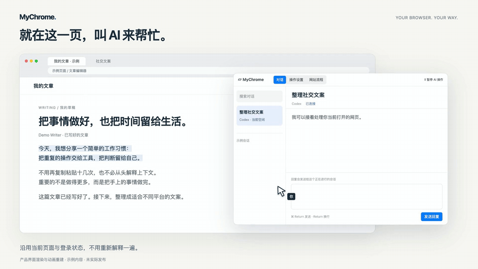

# MyChrome

**你的 Chrome，随时多一双手。**

MyChrome 是本机运行的 MCP server，带原生 macOS app。它让 Codex、Claude Code 和其他本机 stdio MCP 客户端在你正在使用的 Google Chrome 中操作，沿用现有标签页、已登录账号及真实鼠标和键盘。

[产品网站](https://shuaige121.github.io/mychrome-mcp/zh/) · [开始使用](https://shuaige121.github.io/mychrome-mcp/zh/getting-started.html) · [常见问题](https://shuaige121.github.io/mychrome-mcp/zh/faq.html) · [English](README.md)

<p align="center">
  
</p>
<p align="center"><sub>22 秒动图：产品界面渲染与动画重建，示例内容，未实际发布。<br><a href="https://shuaige121.github.io/mychrome-mcp/zh/#film">在网站观看 38 秒完整短片</a></sub></p>


## 什么时候使用 MyChrome，什么时候使用其他浏览器工具

- **公开页面和 API。** 公开信息优先使用 API 或 web fetch。
- **无需登录的 JavaScript 页面。** 页面不需要你的登录会话时，优先使用 headless Playwright。
- **你自己的 Chrome、登录状态或共享页面。** 任务需要现有标签页、已登录账号，或你与助手正在协作的同一页面时，使用 MyChrome。
- **限制自动化访问的网站。** 能否完成取决于网站、账号权限和当前页面。遇到 CAPTCHA 或机器人检查时，MyChrome 停止并交给你处理，不会代为解决；遇到拒绝访问或限流，助手应停止并报告。

## 怎样配合

1. 照常浏览，沿用现有标签页和已登录账号。
2. 在原 AI 对话中用标题或 URL 指明页面及目标。助手先读取页面，在授权范围内操作并核对结果。
3. 密码、验证码或其他个人步骤由你接手。
4. 在原对话中明确说“继续”；助手应重新读取页面再继续。

是否继续由助手遵守交接指令；MyChrome 不强制执行跨客户端的继续授权检查。

## 请求示例

以下是请求示例，不是已验证案例：

- 用我提供的资料更新 LinkedIn 页面。
- 查看我的 Facebook 通知和消息，看看谁在找我。
- 把我写好的文章发布到我指定的 Facebook、Xiaohongshu、Reddit 或 LinkedIn 账号。

兼容性取决于网站、账号权限和当前页面，不保证任何流程一定成功。

## 控制权在你手里

在 0.8 秒内连按两次 Esc，可停止当前 agent 并取回鼠标和键盘；再次接管需要新的指令。停止不会撤销已经发送的操作。暂停控件可阻止所有连接继续输入。接管期间，普通实体输入会被拦截；接管卡片显示 agent、任务、步骤清单、剩余时间和速度。多个 agent 的实体操作共用一套键鼠并排队执行，页面读取可以并行。

不能。遇到 CAPTCHA 或机器人检查时，MyChrome 停止并交给你处理。遇到拒绝访问或限流，助手应停止并报告限制，不应重试或换工具绕过。

## 按你的节奏

输入方式可跟随任务、逐字输入或粘贴，打字、指针和滚动速度可设为 0.5× 至 3×。中文或逐字模式无法输入的文字请用粘贴。可选的个人输入习惯采样仍属实验功能：采样 3 分钟，为后续输入提供时间统计，样本不足的值保留默认设置。可以关闭、重新采样或删除。只保存本机统计摘要，不保存按键、输入文字、屏幕坐标、窗口或 app 名称、截图；原始事件不写入磁盘。它不是行为克隆，也不保证网站接受自动化。

## 连接你的助手

可以。新建对话（⌘N）会启动独立对话：选择已安装并登录的 CLI、该 CLI 的模型、支持的 reasoning effort 和工作目录；首个任务可留空。这些选择不会改写客户端配置。从 app 新建的对话显示实时文字、后续回复及受支持的问题或审批请求；停止生成可中断生成。关闭 app 后对话继续运行；后端进程仍存活时，重新打开可接回，后端退出后不会自动恢复。显示已有 Codex 对话需要受支持的本机集成和关联 thread。

MyChrome 在它所控制的 Chrome 所在的 Mac 上运行。AI 客户端通过自己的账号提供模型访问，可能产生该客户端的费用或订阅费用。

## 0.15.0 新增

- **Claude Code 对话镜像。** 0.15.0 中，连接 MyChrome 的终端 Claude Code 会话会显示为只读镜像，包含连接后的提问和 Claude 回复文字。接管期间，侧栏显示 Claude 回复文字，不显示思考、工具调用或工具结果。你仍在终端回复，MyChrome 不会向终端输入。镜像文字仅保留在内存中，不写入日志或文件。默认开启；在 MCP server 环境中设置 `CHROME_BRIDGE_CLAUDE_FEED=0` 并重新连接 MCP 客户端即可关闭。

- **焦点处理。** 0.15.0 中，Google Chrome 不在前台时，MyChrome 会在操作前将它带到前台，根据指针落点及每次按键前检查的页面键盘焦点判断。如果仍不能操作，会及时返回，说明此前前台是什么以及是否已发送操作。

- **文字识别等待有时限。** 0.15.0 中，如果文字识别较慢，截图会在识别启动约 8 秒后返回，包含图像及文字尚未就绪的说明。后台预热启动前会检查是否正在输入；检测到输入时会推迟启动。

- **使用你已经打开的页面。** 0.15.0 中，当你让助手处理已打开的页面或自己的 Google Chrome 时，MyChrome 的指令会要求它优先使用那个确切标签页，再考虑其他浏览器工具。请重新连接 MCP 客户端以接收新指令。

- **MyChrome 使用你的语言。** 0.15.0 中，MyChrome 的窗口和通知跟随 Mac 的语言（英文或中文），也可在菜单栏面板的设置中选择界面语言；接管卡片及侧栏同样跟随。也可设置 `CHROME_BRIDGE_UI_LANG=en|zh`；面向助手的工具文字不变。

## 开始使用

Codex 和 Claude Code 均可使用浏览器工具；其他本机 stdio MCP 客户端可使用打印出的路径连接。需要 Apple Silicon Mac、macOS 13+、安装在 `/Applications` 的 Google Chrome、原生 arm64 Node.js（推荐 24+，也支持 20.19+ 和 22.13+）、Git 及 Xcode Command Line Tools。不支持 Intel Mac、Rosetta Node、Windows、Linux 或其他浏览器。MyChrome 在它所控制的 Chrome 所在的 Mac 上运行。

```bash
git clone https://github.com/shuaige121/mychrome-mcp.git
cd mychrome-mcp
bash scripts/setup.sh
```

安装程序检查环境、安装依赖、编译原生辅助程序，将 app 安装到 `~/Applications` 并检查权限。它不会改动 AI 客户端配置或授予 macOS 权限。请保留源码目录。MyChrome 通过源码安装，尚未发布到 npm。

运行 `bash scripts/setup.sh --instructions` 获取客户端连接命令，使用 `node src/index.js doctor` 检查权限。不需要扩展、调试端口或单独的浏览器 profile；页面读取使用 Chrome 的“允许来自 Apple 事件的 JavaScript”设置。

0.15.0 中，MyChrome 的窗口和通知跟随 Mac 的语言（英文或中文），也可在菜单栏面板的设置中选择界面语言，或设置 `CHROME_BRIDGE_UI_LANG=en|zh`。面向助手的工具文字不变。

## 数据与隐私

MyChrome 在本机运行，截图和文字识别通过 Mac 上的 Apple Vision 处理。经 MCP 返回的页面内容会交给 AI 客户端，并受该客户端设置约束。网站流程的本机操作元数据记录默认开启，可以关闭；输入和选择的值不会保存为重放默认值。本机记录和流程元数据可能反映你使用的网站，请妥善保管运行记录。

已保存的流程可在你选定的标签页使用新值重放，步骤之间不调用模型；页面或目标不再匹配时会停止。流程完成不代表业务目标已经达成。

## 更多说明

- [源码安装与权限指南](https://shuaige121.github.io/mychrome-mcp/zh/getting-started.html)
- [常见问题](https://shuaige121.github.io/mychrome-mcp/zh/faq.html)
- [AI 操作指南（英文）](docs/ai-guide.md)
- [会话窗口](docs/conversation-center.md) · [网站流程](docs/routines.md)
- [更新记录](docs/release/CHANGELOG.md) · [贡献指南](CONTRIBUTING.md) · [获取帮助](SUPPORT.md) · [安全问题](SECURITY.md)

[MIT License](LICENSE) · Copyright Leonard Chow。MyChrome 是独立项目，与 Google 没有隶属或背书关系。Chrome 是 Google LLC 的商标。
